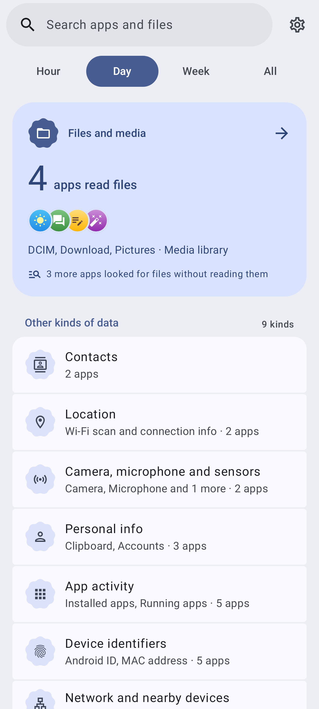
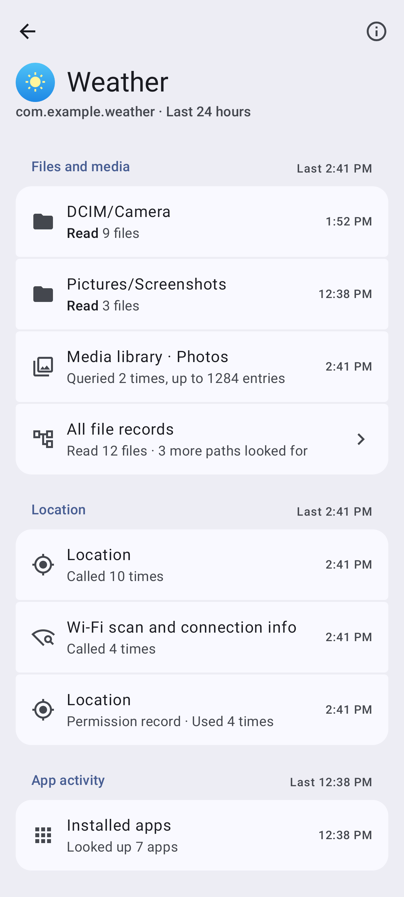
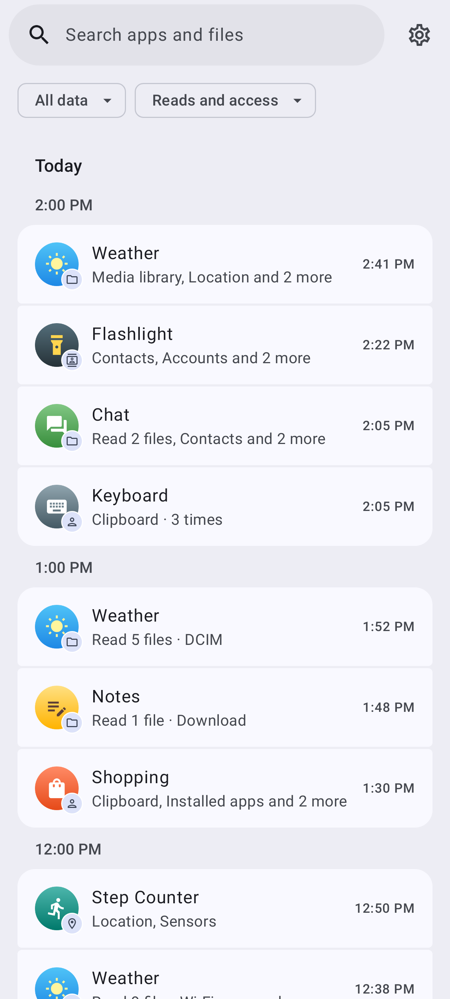
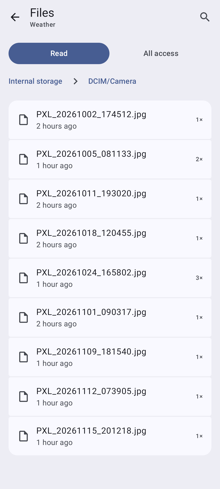
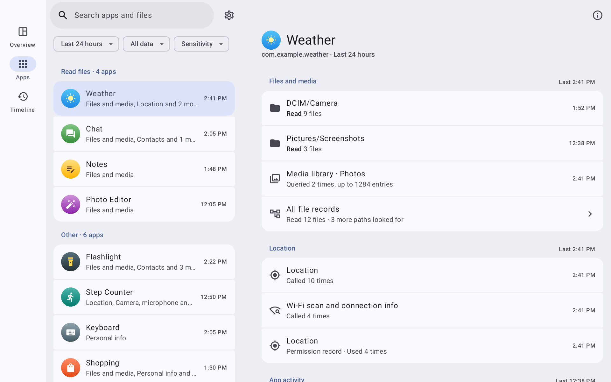

# Big Brother

[](https://github.com/lihenggui/bigbrother/actions/workflows/ci.yml)
[](https://github.com/lihenggui/bigbrother/releases/latest)
[](LICENSE)

English | [简体中文](README.zh-CN.md)

Big Brother records which apps on a rooted Android device read your files,
collect device identifiers or ask the system for other private data, and
when. It consists of a root module that does the recording and an app to
browse the records. Nothing leaves the device.

<p>
  
  
  
  
</p>
<p>
  
</p>

The apps and records in the screenshots are sample data.

## What it records

- Files: each file on shared storage an app opened, with the time and how
  often. Listing a folder, checking whether a file exists and watching for
  changes are recorded separately from reading, as are attempts the system
  denied. Files opened through MediaStore, the Storage Access Framework or
  the download provider are attributed to the app that asked for them
  (requires LSPosed).
- Device identifiers and system information: reads of `/proc`, `/sys` and
  `/dev` entries that identify the device or reveal its state, such as
  hardware addresses, serial numbers, the ARP table, other processes, and
  root and emulator checks.
- Requests to system services: the list of installed apps, the clipboard,
  the location, Wi-Fi networks, phone identifiers, accounts, running apps,
  usage statistics and sensors, and reads of the Android ID.
- Permission use: use of the camera, microphone, location and other
  sensitive permissions, and refusals, from the system's app-ops records.
- Personal data: queries for contacts, the call log, text messages and the
  calendar (requires LSPosed). Only the kind of data is recorded, never
  which contact or message.
- Other activity: programs an app runs to probe the device (`getprop`,
  `pm list packages`, attempts to run `su`), connections to ports on the
  device and to the local network, network configuration requests over
  netlink, and attempts to read another app's memory.

Records are kept for 30 days.

## Requirements

- Android 12 or later on an arm64 or x86_64 device
- A GKI 2.0 kernel (5.10 or newer) with BTF; the file
  `/sys/kernel/btf/vmlinux` must exist
- Root with module support: [KernelSU](https://kernelsu.org),
  [Magisk](https://github.com/topjohnwu/Magisk) or
  [APatch](https://apatch.dev)
- Optional: [LSPosed](https://github.com/LSPosed/LSPosed) (Xposed API 101
  or newer), for access through content providers

On x86_64, which covers the Android emulator, only 64-bit apps are
recorded. Development and testing are done on Android 16 with kernel 6.6
and KernelSU.

## Installation

Download `big_brother-<version>.zip` from the
[latest release](https://github.com/lihenggui/bigbrother/releases/latest).
The file is both the module and the app. Then either:

- flash it in your root manager, which installs the app as well, or
- rename it to `.apk` and install it, open the app, grant it root and tap
  "Install module".

Restart the device, except on KernelSU, which applies the module
immediately. Settings shows "Recording" once the module is running.

To record access through content providers, enable Big Brother in LSPosed,
keep the suggested scope (the media, external storage and download
providers, and the contacts, telephony and calendar providers) and restart.

The module can also be installed from a root shell:

```sh
ksud module install big_brother-<version>.zip       # KernelSU
magisk --install-module big_brother-<version>.zip   # Magisk
apd module install big_brother-<version>.zip        # APatch
```

### Updating

Flash the new `.zip`, or install it over the old app as an `.apk`, then
open the app. It replaces the module's files with its own and restarts the
recording, without a restart of the device.

### Uninstalling

Remove the module in your root manager and restart; this also deletes the
records. Then uninstall the app.

## Usage

- Overview: the kinds of data accessed in the selected period (last hour,
  24 hours, 7 days or all), with the number of apps for each. The first card
  shows the apps that read files.
- Apps: every app with records, the most sensitive first. An app's page
  shows the files it read, their folders, the other data it asked for, and
  the time of each access.
- Timeline: what each app did, hour by hour.
- Search: apps, file names and kinds of data across all records.

System apps are hidden by default, since reading data is part of how they
work. They can be shown in Settings.

How an access is described:

| In the app | Meaning |
| --- | --- |
| Read | The app opened the file and the system allowed it. |
| Listed, Probed, Watched | It listed a folder, checked whether a file exists, or watched it for changes. Nothing was read. |
| Denied | The system refused the access. |
| Read via provider, Queried | A system provider (the media library, for example) opened the file or ran the query on the app's behalf. |
| Used | A permission the app used, as recorded by the system. |

## FAQ

### The overview says "Recording stopped"

Tap "Start recording". If it stops again, tap "Export logs" in Settings
and attach the file to an [issue](https://github.com/lihenggui/bigbrother/issues).

### Nothing from the media library, contacts or messages is recorded

These are recorded by the LSPosed hook. Enable it as described under
Installation.

### Does it block anything?

No. It records access; it does not prevent it.

### Does it drain the battery?

The module holds no wakelocks and does nothing while the device sleeps.
While the device is awake and idle it wakes about once every ten seconds,
and writes to its database only when there is something to record.

### Where are the records?

In `/data/adb/big_brother`, readable only by root.

## Privacy

The app has no network access: the INTERNET permission is removed from its
manifest, and CI fails if the APK requests a new permission. Records stay
in `/data/adb/big_brother` until they are 30 days old or the module is
removed. Exported logs contain the app's and the module's logs and the
device and version details listed in the file; they are shared only if you
choose to.

## Limitations

- Without the LSPosed hook, access through content providers is not
  recorded. With it, only successful provider calls are, and a query is
  recorded as the collection and the number of rows returned.
- Existence checks, inotify watches and opens that fail during path lookup
  are matched on the path string the app passed, and can be evaded by an
  app that spells the path unusually. Successful opens cannot.
- A request to a system service is recorded when it is made; the answer,
  or a refusal, is not seen. Until the device's method numbers are known,
  shortly after boot, such requests are not recorded.
- Permission use is read from the system twice a minute. The system keeps
  the latest use and the latest refusal per app and permission, so several
  uses in between count as one.
- Connections are recorded when attempted; whether they succeeded is not
  known. On mobile data, the carrier's private addresses count as the local
  network.
- A command line is recorded up to six arguments of 63 bytes each.
- File operations an app delegates to a privileged process (root, Shizuku)
  are not attributed to it.
- Files already open when the module starts are not seen.
- A record means a file was opened, not how much of it was read.

## How it works

eBPF programs in the kernel observe file opens, related system calls,
program execution, connections, netlink requests and binder transactions,
and pass them to a daemon that classifies them and stores them in SQLite.
The optional LSPosed hook reports who queried or opened what in the
system's content providers. The app reads the daemon's output as root.
See [docs/how-it-works.md](docs/how-it-works.md).

## Contributing

Bug reports and pull requests are welcome. See
[CONTRIBUTING.md](CONTRIBUTING.md) for building, testing and the project's
conventions.

## License

Copyright (C) 2026 Mercury Li

This program is free software: you can redistribute it and/or modify it
under the terms of the GNU General Public License version 3 as published by
the Free Software Foundation. See [LICENSE](LICENSE).

The eBPF programs (`bb-ebpf/`) and the types they share with the daemon
(`bb-common/`) are loaded into the kernel and are licensed under the GNU
General Public License version 2 or, at your option, any later version. See
[LICENSE-GPL-2.0](LICENSE-GPL-2.0).

The app's module structure follows
[Now in Android](https://github.com/android/nowinandroid), as used by
[Blocker](https://github.com/lihenggui/blocker). The Cargo build scripts are
based on [aya-template](https://github.com/aya-rs/aya-template).
