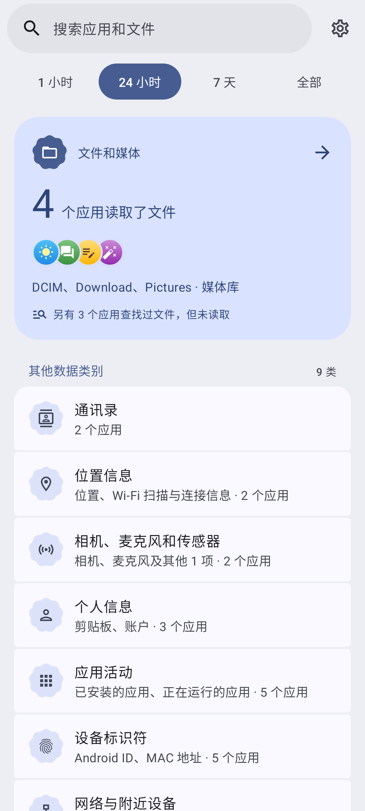
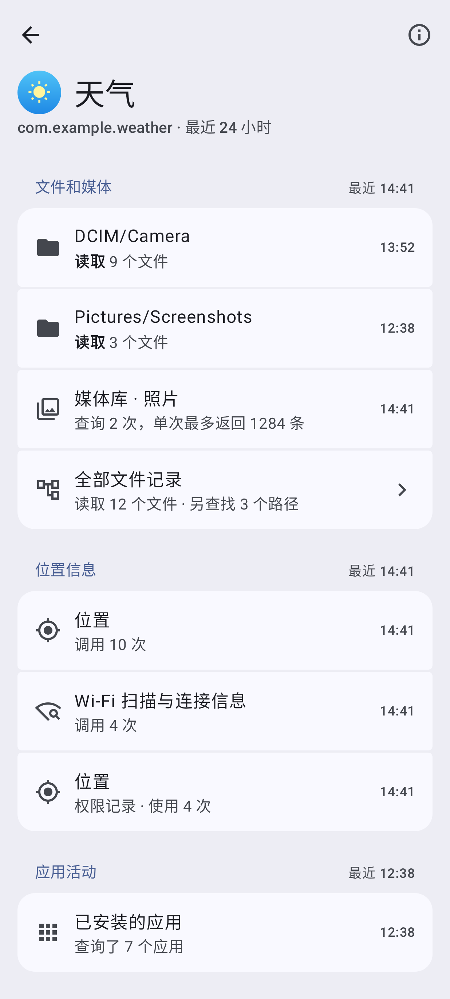
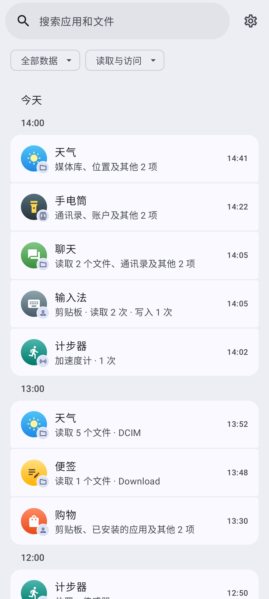
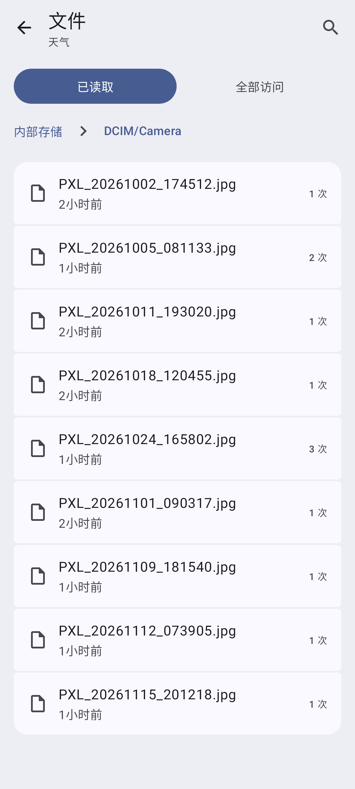
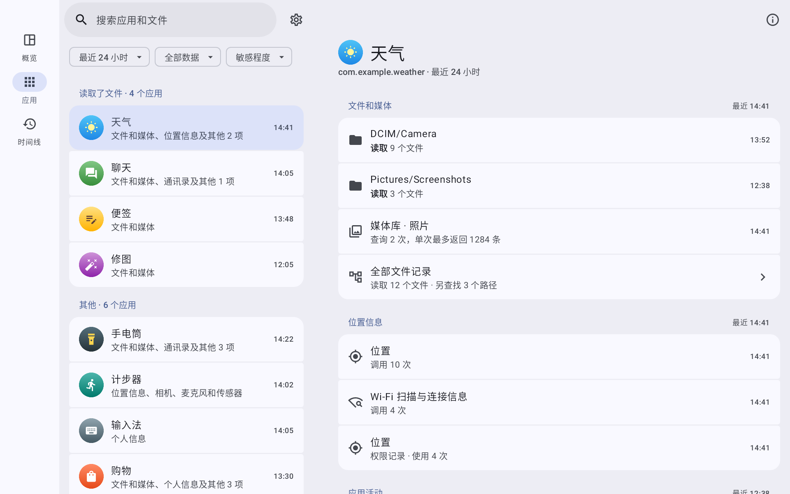

# Big Brother

[](https://github.com/lihenggui/bigbrother/actions/workflows/ci.yml)
[](https://github.com/lihenggui/bigbrother/releases/latest)
[](LICENSE)

[English](README.md) | 简体中文

Big Brother 用于在已 root 的 Android 设备上记录应用对隐私数据的访问，包括读取的文件、
获取的设备标识、调用的系统服务，以及每次访问的时间。项目由负责采集的 root 模块和用于
查看记录的应用组成，所有数据仅保存在本机。

<p>
  
  
  
  
</p>
<p>
  
</p>

截图中的应用和记录均为示例数据。

## 功能

记录以下几类访问：

- 文件：应用在共享存储中打开的文件，以及打开的时间和次数。列出目录、检查文件是否存在、
  监听文件变化单独记录，不计为读取；被系统拒绝的访问单独标注。经 MediaStore、SAF 或下载
  管理器打开的文件，归属于发起请求的应用（需要 LSPosed）。
- 设备标识与系统信息：读取 `/proc`、`/sys`、`/dev` 中可用于识别设备或反映设备状态的条目，
  例如 MAC 地址、序列号、ARP 表、其他进程的信息，以及 root 检测和模拟器检测。
- 系统服务调用：获取已安装应用列表、剪贴板（读取、写入或监听变化）、位置、Wi-Fi 列表、
  电话标识、账户、运行中的应用和使用情况统计，以及读取 Android ID。
- 传感器：应用开启了哪些传感器、开启的时间和时长，以及请求的采样率；200 Hz 及以上标为
  高采样率。
- 权限使用：相机、麦克风、定位等敏感权限的使用与拒绝，数据来自系统的 AppOps 记录。
- 个人数据：查询通讯录、通话记录、短信和日历（需要 LSPosed）。仅记录数据类别，不记录具体的
  联系人或短信。
- 其他行为：执行用于探测设备的命令（如 `getprop`、`pm list packages`、尝试执行 `su`），
  连接本机端口或局域网设备，通过 netlink 查询网络配置，以及尝试读取其他应用的内存。

记录保留 30 天。

## 环境要求

- Android 12 及以上，arm64 或 x86_64 架构
- GKI 2.0 内核（5.10 及以上）并启用 BTF，可通过 `/sys/kernel/btf/vmlinux` 是否存在确认
- 支持模块的 root 方案：[KernelSU](https://kernelsu.org)、
  [Magisk](https://github.com/topjohnwu/Magisk) 或 [APatch](https://apatch.dev)
- 可选：[LSPosed](https://github.com/LSPosed/LSPosed)（Xposed API 101 及以上），
  用于记录经内容提供程序的访问，并为“监狱”提供系统框架中的隔离功能

在 x86_64 设备（包括 Android 模拟器）上仅记录 64 位应用。开发与测试环境为 Android 16、
内核 6.6 和 KernelSU。

## 安装

从 [Releases](https://github.com/lihenggui/bigbrother/releases/latest) 下载
`big_brother-<version>.apk.zip`。该文件同时是模块和应用，可选择以下任一方式安装：

- 在 root 管理器中刷入，应用会随之安装。
- 去掉文件名末尾的 `.zip`，安装得到的 APK，打开应用并授予 root 权限，点击“安装模块”。

安装后重启设备。KernelSU 无需重启，模块立即生效。模块运行后，设置页面显示“正在记录”。

如需使用这些功能，在 LSPosed 中启用 Big Brother 并保留推荐作用域。媒体、外部存储、下载、
通讯录、电话和日历提供程序用于记录访问。**系统框架**作用域让“监狱”管理 Android ID、广告 ID、
已安装应用的可见性和系统文件选择器的文件授权。启用模块后重启设备。

也可以在 root shell 中安装模块：

```sh
ksud module install big_brother-<version>.apk.zip       # KernelSU
magisk --install-module big_brother-<version>.apk.zip   # Magisk
apd module install big_brother-<version>.apk.zip        # APatch
```

### 更新

从早于 v0.3.0 的构建更新时，请先解除已有的应用隔离，按下方步骤移除旧模块和应用，再安装 v0.4.2。

后续更新可刷入新版 `.zip`，或将其改为 `.apk` 后覆盖安装，再打开应用更新模块。

### 卸载

在 root 管理器中移除模块并重启，已有记录随模块一并删除，之后卸载应用。

## 使用说明

- 概览：按所选时间范围（最近 1 小时、24 小时、7 天或全部）列出被访问的数据类别及涉及的
  应用数量。第一张卡片显示读取过文件的应用。
- 应用：列出所有有记录的应用，按敏感程度排序。应用详情中可查看其读取的文件、所在目录、
  访问的其他数据，以及每次访问的时间。
- 时间线：按小时展示各应用的行为。
- 搜索：在全部记录中检索应用、文件名和数据类别。
- 监狱：可全局或逐个应用设置隔离项目，也可自动隔离新安装的应用。还可以切断单个应用的网络、
  记录其连接的目的地，或单独屏蔽指定目的地。

系统应用默认隐藏，可在设置中开启显示。

记录中各操作的含义：

| 显示 | 含义 |
| --- | --- |
| 读取 | 应用打开了文件，系统允许访问。 |
| 列出、探测、监听 | 列出目录、检查文件是否存在或监听文件变化，未读取内容。 |
| 被拒绝 | 系统拒绝了此次访问。 |
| 经内容提供程序读取、查询 | 由系统的 ContentProvider（如媒体库）代为打开文件或执行查询。 |
| 使用 | 系统记录的权限使用。 |

## 常见问题

### 概览提示“记录已停止”

点击“启动记录”。如果仍然停止，请在设置中点击“导出日志”，并将生成的文件附在
[issue](https://github.com/lihenggui/bigbrother/issues) 中。

### 没有媒体库、通讯录或短信相关的记录

这类访问由 LSPosed 模块记录，请参照“安装”一节启用。

### 是否会拦截访问

默认不会：Big Brother 只记录访问，不阻止访问。可在“监狱”中隔离应用：被隔离的应用使用
独立的存储（初始为空），读不到个人数据，并获得独立的设备标识。每一项既可对所有隔离应用
统一设置，也可单独设置；此后安装的应用也可在首次启动前自动隔离。Android ID、广告 ID、
已安装应用可见性和系统文件选择器的文件授权需要 LSPosed 的**系统框架**作用域。
详见 [docs/sandbox.md](docs/sandbox.md)（英文）。

### 对续航的影响

模块不持有 WakeLock，设备休眠期间不运行。设备唤醒且空闲时约每 10 秒唤醒一次，仅在有新
记录时写入数据库。

### 记录保存位置

`/data/adb/big_brother`，仅 root 可读。

## 隐私

应用不具备网络访问能力：清单中已移除 INTERNET 权限，APK 申请任何新权限都会导致 CI 失败。
记录保存在 `/data/adb/big_brother`，超过 30 天或移除模块时删除。导出的日志包含应用与模块
的日志，以及文件中列出的设备和版本信息，仅在用户主动分享时离开设备。

## 已知限制

- 未启用 LSPosed 模块时，无法记录经 ContentProvider 的访问；启用后也仅记录成功的调用，
  查询只记录集合名称和返回的行数。
- 存在性检查、inotify 监听，以及在路径解析阶段失败的打开操作，按应用传入的路径字符串匹配，
  使用非常规的路径写法可以绕过。成功的打开操作无法绕过。
- 系统服务调用在发起时记录，无法得知服务的返回结果或是否拒绝。开机后获取本机方法编号之前
  的短暂时间内，此类调用不会被记录。
- 通过直接通道（SensorDirectChannel，用于极高采样率）读取的传感器数据不会被记录。
- 权限使用每分钟从系统读取两次。系统对每个应用的每项权限只保留最近一次使用和最近一次拒绝，
  两次读取之间的多次使用只计为一次。
- 连接在发起时记录，无法得知是否成功。使用移动数据时，运营商分配的私有地址会被视为局域网。
- 命令行最多记录 6 个参数，每个参数最长 63 字节。
- 应用委托给特权进程（root、Shizuku）执行的文件操作不会归属于该应用。
- 模块启动前已打开的文件无法观测。
- 一条记录表示文件被打开过，不代表读取了多少内容。

## 工作原理

内核中的 eBPF 程序观测文件打开、相关系统调用、程序执行、网络连接、netlink 请求和 binder
事务，由守护进程分类后写入 SQLite。可选的 LSPosed 模块在系统内容提供程序中记录查询和打开操作的
调用方，并在系统框架中执行“监狱”的隔离设置。应用以 root 身份读取守护进程的输出。详见
[docs/how-it-works.md](docs/how-it-works.md)（英文）。

## 参与贡献

欢迎提交 issue 和 pull request。构建、测试和项目约定见 [CONTRIBUTING.md](CONTRIBUTING.md)
（英文）。

## 许可证

Copyright (C) 2026 Mercury Li

本程序是自由软件，可依据自由软件基金会发布的 GNU 通用公共许可证第 3 版重新发布和修改。
详见 [LICENSE](LICENSE)。

eBPF 程序（`bb-ebpf/`）及其与守护进程共用的类型（`bb-common/`）会被加载到内核中，采用
GNU 通用公共许可证第 2 版或（由您选择）任何更新的版本，详见 [LICENSE-GPL-2.0](LICENSE-GPL-2.0)。

应用的模块划分参照 [Now in Android](https://github.com/android/nowinandroid)，与
[Blocker](https://github.com/lihenggui/blocker) 相同。Cargo 构建脚本基于
[aya-template](https://github.com/aya-rs/aya-template)。
